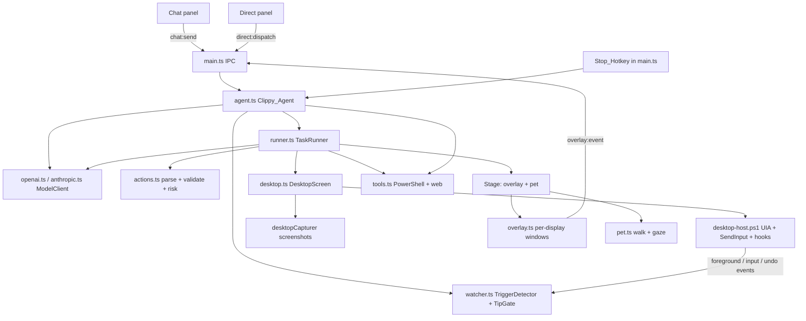
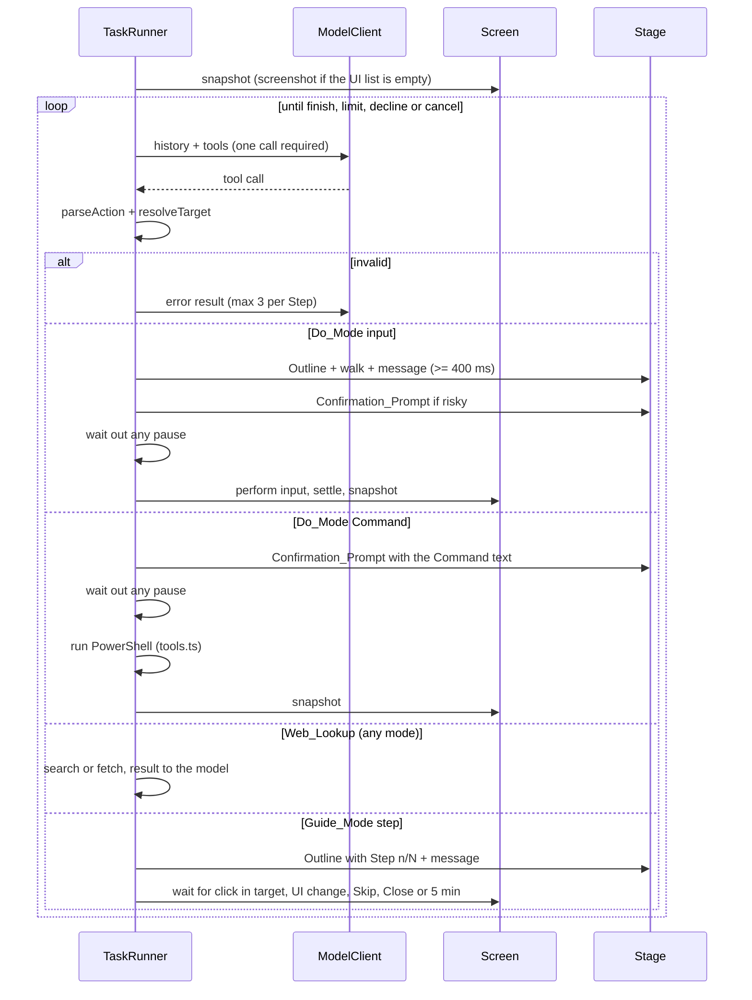

# Design Document: Clippy Agent

## Overview

The Clippy_Agent turns Clippy from a scripted pet into an assistant that sees the screen and acts on it. It answers chat with knowledge of the active window, runs Tasks either as a guide (Clippy frames each control and the user clicks) or by doing them (Clippy clicks and types), carries out voice commands, and offers unprompted Tips when the user switches windows, hits a dialog or seems stuck.

The agent runs in the Electron main process. Windows UI Automation and input go through a long-lived PowerShell host with embedded C#, the same pattern as the existing speech host. Screenshots come from Electron's `desktopCapturer`. Models are reached through a provider-neutral `ModelClient` with an OpenAI adapter (Responses API, needed for tool calling on current OpenAI models) and an Anthropic adapter (official SDK, Messages API). Every model turn must be one tool call, which the agent parses and validates before anything touches the screen. Off-screen tools live in `tools.ts`: Commands run in Windows PowerShell after a Confirmation_Prompt, and Web_Lookups go to DuckDuckGo's HTML results page or fetch one page as text.

Clippy's presence on screen comes from two places: the existing pet window, which now walks next to targets and looks at them, and new per-display overlay windows that draw Outlines (Win9x window frames with a see-through middle and a title bar) and the task speech bubble.

## Architecture



A Task runs as a loop:



## Components and Interfaces

### Component 1: Actions (`src/main/agent/actions.ts`)

**Purpose**: Defines the tools models may call and turns tool calls into typed Actions.

**Interface**:

```ts
parseAction(name: unknown, input: unknown): { ok: true; action: Action } | { ok: false; error: string }
actionInput(action: Action): { name; input }          // inverse of parseAction
toAnthropicToolUse / fromAnthropicToolUse
toOpenAIFunctionCall / fromOpenAIFunctionCall
parseTarget(s): Target | null; formatTarget(t): string
resolveTarget(t, ScreenContext): { ok; target: { rect; name } } | { ok: false; error }
isRisky(action, targetName): boolean
```

**Responsibilities**:

- Hold the JSON schemas for every tool and the per-mode tool lists (`TASK_TOOLS`); Guide_Mode has no input tools and only Do_Mode has `run_command`. Chat, Guide_Mode and Do_Mode all have `web_search` and `fetch_url`.
- Enforce types, enums and limits (type-text up to 2000 characters, messages up to 200, Commands up to 4000 with a 1 to 300 second timeout, queries up to 200, URLs up to 2000 and http or https only).
- Resolve targets against the latest UI_Snapshot or screenshot, and reject anything off every display.
- Classify Risky_Actions from the model's flag, a risky-word list on the target's name, and risky key combinations. Every Command is risky.

### Component 2: Model providers (`model.ts`, `openai.ts`, `anthropic.ts`, `prompts.ts`)

**Purpose**: One request shape for both providers.

**Interface**:

```ts
interface ModelClient {
  provider: "openai" | "anthropic";
  complete(req: ModelRequest): Promise<ModelReply>; // streams text through req.onText
}
```

**Responsibilities**:

- Convert provider-neutral history (user parts, assistant turns with the provider's native output, tool results with optional images) into each API's format, and back.
- OpenAI: Responses API, `store: false`, function calls replayed without item ids, tool-result images sent as a follow-up user turn, `tool_choice: "required"` in task loops, SSE streaming for chat.
- Anthropic: Messages API through `@anthropic-ai/sdk`, assistant content replayed unchanged (thinking blocks included), images nested in `tool_result`, `tool_choice: auto` with parallel calls disabled (forced tool use is rejected by current models), prompt caching, `output_config.effort`, and the server-side refusal fallback on models that support it.
- Map failures to `ModelError` kinds: auth, rate, network, timeout (60 s), bad-request, no-vision, server, aborted.

### Component 3: TaskRunner (`runner.ts`)

**Purpose**: Runs one Guide_Mode or Do_Mode Task.

**Interface**:

```ts
new TaskRunner({ screen: Screen, stage: Stage, clock?, timing? })
run(spec: { goal; mode; client; model; effort? }, signal): Promise<TaskOutcome>
```

**Responsibilities**:

- Perceive, ask, validate, act, repeat; 30 Steps in Do_Mode (Commands included), 20 in Guide_Mode, 3 invalid turns per Step.
- Run Commands only after Yes on a Confirmation_Prompt that shows the Command, then return the output and a fresh snapshot. Pass Web_Lookups through `lookup`, which turns failures into error results.
- Take the local tools as a constructor option (`local`, default `localTools`) so tests run without PowerShell or the network.
- Show the Outline and walk Clippy over at least 400 ms before input; confirm Risky_Actions (30 s, silence is No).
- Pause on User_Input during Do_Mode, ask Continue or Stop (60 s), and re-plan from a fresh snapshot on Continue.
- Detect Guide_Mode step completion from a click inside the target, a UI fingerprint change after typing or between polls, Skip, Close, or a 5-minute timeout.
- Keep Outlines on moving elements by re-reading their bounds.
- Fall back to UI-list-only history when the model rejects images.

### Component 4: Desktop host and screen (`native/desktop-host.ps1`, `desktop.ts`)

**Purpose**: Windows-only screen reading, input and event hooks; screenshots everywhere.

**Interface** (tab-separated commands, JSON replies and events on stdout):

```
<id> snapshot <maxElements> <budgetMs>   → { foreground, windows, elements, truncated }
<id> bounds <elementId>                  → rect | null
<id> click|type|keys|scroll ...          → true
<id> watch <input 0|1> <undo 0|1>
events: ready, foreground, input {kind, x, y}, undo
```

**Responsibilities**:

- Per-monitor DPI aware, so coordinates are physical pixels; `desktop.ts` converts to and from Electron DIPs.
- Breadth-first UI Automation walk of the target window with a cache request, focus chain first, capped at 500 elements and a time budget; password values are never read.
- Leave Clippy's own process out of snapshots and foreground events; hide Clippy's windows from screenshots with content protection while capturing.
- Low-level mouse and keyboard hooks report only the user's own input (injected input is ignored) and Ctrl+Z, never which keys were pressed.

### Component 5: Overlay and pet (`overlay.ts`, `renderer/overlay/`, `pet.ts`)

**Purpose**: Clippy's visible behaviour during Tasks and Tips.

**Responsibilities**:

- One transparent, non-focusable, always-on-top window per display, created on first use and hidden when empty; only the Outline title bar and the bubble take clicks.
- Outline: 4 px Win9x frame around the target with a glowing edge, title bar above (or below at the screen top) with step badge, description (60 characters), Skip and Close.
- Bubble: the pet's speech-bubble style with buttons, anchored above Clippy's body and following him as he moves.
- `placeNear` puts Clippy's body and bubble zone next to the target inside the work area, falling back to the farthest corner; walks take 300 to 1000 ms; Clippy looks at the target and returns home when done.

### Component 6: Clippy_Agent and Watcher (`agent.ts`, `watcher.ts`)

**Purpose**: Entry points and proactive tips.

**Responsibilities**:

- Chat: last 40 messages plus the current UI list; the model may take a screenshot, run Web_Lookups or call `start_task`, over at most 6 model turns. Tasks from chat hide the chat panel and post the result back to it. While a reply streams, the send button is a Stop button.
- The Stop_Hotkey, registered in `main.ts` alongside the Direct hotkey, ends the running Task and aborts every streaming chat reply.
- Direct: always a Do_Mode Task with the Fast_Model; the result shows in an 80-character bubble.
- One Task at a time; a new one ends the running one.
- Watcher: a foreground window that stays 3 s, a new dialog, 20 s idle on a dialog, or three Ctrl+Z in 10 s. The TipGate skips triggers while tips are off, a Task runs, Clippy is hidden, a bubble is up, the window is full screen, or no key is saved, and spaces evaluations 30 s and tips by the Tip_Interval. A Fast_Model call on the UI list decides; only then does the Main_Model write the tip with a screenshot. Tips hide after 15 s untouched; closing one mutes that application for 30 minutes; "Show me" starts a guide.

### Component 7: Local tools (`tools.ts`)

**Purpose**: Commands and Web_Lookups, free of Electron imports.

**Interface**:

```ts
runCommand(command, timeoutSeconds = 60, signal?): Promise<string> // "exit code: N\n<output>"
webSearch(query, signal?): Promise<string>                          // up to 8 "title\nurl\nsnippet" entries
fetchUrl(url, signal?): Promise<string>                             // HTML reduced to text
lookup(tools, action, signal?): Promise<{ text; isError? }>         // runs web_search or fetch_url
```

**Responsibilities**:

- Run Commands through `powershell.exe -NonInteractive` with the script base64-encoded, UTF-8 output, the user's home folder as working directory, and stdout and stderr merged; kill the process on abort or timeout (at most 300 s).
- Search by posting to DuckDuckGo's HTML endpoint and unwrapping its redirect links; fetch pages with a 20 s timeout and strip scripts, styles and tags from HTML.
- Cap every result at 12000 characters.

## Data Models

### Model 1: Action and Target

```ts
type Target = { element: string } | { box: { x; y; width; height } }; // "e12" or "x,y,w,h" on the wire
type Action =
  | { type: "click"; target; button; double; risky; explanation }
  | { type: "type_text"; target | null; text; risky; explanation }
  | { type: "press_keys"; keys; risky; explanation }
  | { type: "scroll"; target; direction; amount; explanation }
  | { type: "guide_step"; target; title; text; total }
  | { type: "run_command"; command; timeout_seconds; explanation }
  | { type: "web_search"; query } | { type: "fetch_url"; url }
  | { type: "screenshot" } | { type: "wait"; seconds } | { type: "say"; text }
  | { type: "finish"; success; summary }
  | { type: "start_task"; goal; mode } | { type: "assess"; worthwhile; subject }
  | { type: "show_tip"; text; title; target | null; follow_up | null };
```

**Validation Rules**:

- Element ids match `e` plus up to 5 digits and must exist in the latest snapshot.
- Boxes need a screenshot and must lie inside it; they map to DIP through the screenshot's display bounds.
- Key combinations use known key names with modifiers first; a lone modifier is only valid for `win`.
- `timeout_seconds` is a whole number from 1 to 300, 60 when omitted; `url` starts with `http://` or `https://`.

### Model 2: UiSnapshot

```ts
type UiSnapshot = {
  foreground: WindowInfo | null; // hwnd, title, process, pid, className, rect, isDialog, fullScreen
  windows: WindowInfo[];
  elements: { id; name; type; rect; enabled; focused; focusChain; value?; depth }[];
  truncated: boolean;
};
```

**Validation Rules**:

- At most 500 elements; truncation keeps focus-chain elements.
- The fingerprint covers the active window and each element's type, name, value, enabled state and focus, not positions.

## Correctness Properties

1. **Tool-call round trip**: for every valid Action, `parseAction(actionInput(a))`, the Anthropic `tool_use` round trip and the OpenAI `function_call` round trip return an equal Action. Validates 15.4, 15.5.
2. **Target round trip**: `parseTarget(formatTarget(t)) = t` for every valid Target. Validates 15.2.
3. **Placement invariant**: for every target and work area, Clippy's footprint lies inside the work area and, unless the fallback corner was used, does not overlap the target. Validates 10.1, 10.4.
4. **Walk bounds**: every walk lasts 300 to 1000 ms. Validates 10.2.
5. **SSE round trip**: any sequence of events, serialized and split into arbitrary chunks (LF or CRLF), parses back to the same events. Supports 3.1.
6. **No input in Guide_Mode**: a Guide_Mode Task never calls `perform`. Validates 6.2.
7. **Risky actions never run unconfirmed**: a Risky_Action, every Command included, runs only after Yes; No and silence end the Task with no input sent and no Command run. Validates 8.2, 8.5, 8.6, 17.1, 17.2.
8. **Pause blocks input**: after User_Input in Do_Mode, no input is sent until Continue; the pending Action is dropped and re-planned. Validates 9.1, 9.3.
9. **Limits**: Do_Mode sends at most 30 inputs and Commands per Task; invalid turns end the Task after 3 retries per Step. Validates 7.6, 7.7, 15.3, 17.8.
10. **Commands only in Do_Mode**: no tool list but Do_Mode's contains `run_command`, and the runner rejects any Action outside its mode's list. Validates 17.3.

## Error Handling

### Error Scenario 1: Missing API key

**Condition**: The selected provider has no saved key.
**Response**: A bubble names the missing key; chat shows the same error; no Task starts; the Watcher stays quiet.
**Recovery**: The user adds the key in Settings → AI.

### Error Scenario 2: Model failure

**Condition**: Network error, rate limit, auth error, bad request or no reply within 60 s.
**Response**: The Task ends and the bubble describes the failure.
**Recovery**: The user retries; the next request uses fresh settings.

### Error Scenario 3: Model cannot read images

**Condition**: The provider rejects a request containing images.
**Response**: The runner strips images from the history, tells the user once, and continues with UI lists only.

### Error Scenario 4: Invalid or impossible Action

**Condition**: Unknown tool, bad arguments, missing element, box off-screen, cut-off tool call.
**Response**: An error tool result goes back to the model; after 3 in one Step the Task ends with a bubble.

### Error Scenario 5: Desktop host unavailable

**Condition**: Not Windows, PowerShell or UI Automation missing, host crash or timeout.
**Response**: Snapshots return null and the runner falls back to screenshots; Do_Mode reports that it needs Windows; the host restarts on next use.

### Error Scenario 6: Web_Lookup failure

**Condition**: Network error, non-2xx status, or no response within 20 s.
**Response**: `lookup` returns `Failed: <reason>` as an error result; the model may retry or answer without it, and 3 failed turns in one Step end a Task.

### Error Scenario 7: Command fails or hangs

**Condition**: The Command exits non-zero, writes to stderr, or outlives its timeout.
**Response**: The exit code (`killed` on timeout or abort) and the output go back to the model as a normal result, so the model can fix the Command or stop.

## Testing Strategy

### Unit Testing Approach

`node --test` suites cover action parsing and limits, risk rules, target resolution, key parsing, snapshot formatting and fingerprints, trigger detection and tip gating, provider request and response conversion (with a fake `fetch` for OpenAI, including streaming and error mapping), and the TaskRunner against fake Screen, Stage and ModelClient implementations: do-it flow, confirmations, timeouts, pauses, retries, limits, guide completion by click, keys, Skip, Close and timeout, the no-vision fallback, cancellation and model errors, confirmed and declined Commands, and Web_Lookups with a fake `local` tool set. Search-result parsing and HTML-to-text have their own tests, and on Windows a real PowerShell run checks that stderr comes back as plain text.

### Property-Based Testing Approach

Properties 1 to 5 run over a few hundred to a few thousand generated cases each, from a seeded PRNG so failures reproduce.

**Property Test Library**: none; seeded generators written in the tests, so no new dev dependency is needed.

### Integration Testing Approach

The desktop host, overlay windows and live model calls need Windows and API keys, so they are checked by hand: guide and do-it tasks in Notepad, a risky "Send" in a mail client, a pause by moving the mouse, a confirmed and a declined Command, a chat answer that needs a web search, the Stop_Hotkey during a Task, a dialog tip, and multi-monitor and high-DPI Outline alignment.

## Performance Considerations

- The host walks the UI tree with a cache request and stops at 500 elements or 1.1 s; the request times out at 2.5 s.
- Screenshots are taken only when the UI list is empty or the model asks, scaled to a 1568 px long edge and sent as JPEG.
- After each action, an unchanged screen is reported as "unchanged" instead of a full UI list; history stays append-only so provider prompt caching keeps working.
- Tips cost at most one Fast_Model call per 30 s and one Main_Model call per Tip_Interval.
- Overlay windows exist only on displays that have shown something, and hide when empty.
- Command output and fetched pages are capped at 12000 characters; searches return at most 8 results.

## Security Considerations

- API keys stay in the main process (safeStorage); renderers only see "is set" flags.
- Every model-proposed Action is validated before it runs; risky actions need a click on Yes.
- User_Input pauses Do_Mode immediately; prompts expire to the safe answer.
- Password fields are never read, key hooks never report which key was pressed, and Clippy's own windows are kept out of what models see.
- Screen data stays in memory and is sent only to the selected provider.
- Commands run with the user's rights, so each one needs a Confirmation_Prompt that shows its text; chat and Guide_Mode cannot run Commands.
- Web, window and Command text can carry prompt injection. The prompts tell models to treat it as data and report it, but nothing enforces that, so the Confirmation_Prompt is the real guard. Search queries go to DuckDuckGo.

## Dependencies

- `@anthropic-ai/sdk` (Anthropic Messages API).
- OpenAI Responses API over `fetch`.
- Windows PowerShell 5.1 with .NET Framework UI Automation (`UIAutomationClient`, `UIAutomationTypes`, `WindowsBase`).
- Electron `desktopCapturer`, `screen` DIP conversion, `setContentProtection` and `globalShortcut` for the Stop_Hotkey.
- DuckDuckGo's HTML results page (`html.duckduckgo.com/html/`) for web search, scraped without an API key.
