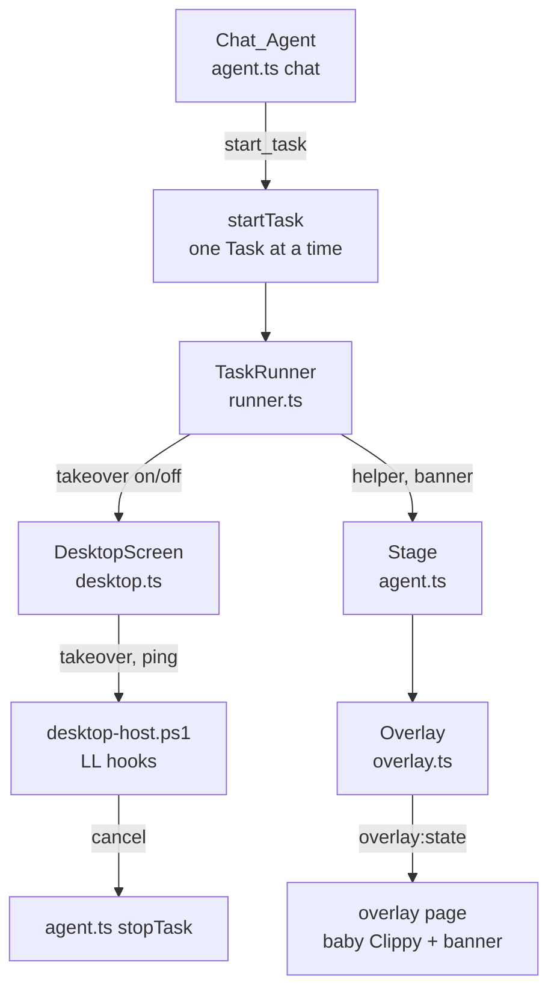

# Design Document: Screen Helper

## Overview

Chat stays a talker: its system prompt says it only chats and delegates, and its tools are limited to `start_task`, `web_search`, `fetch_url` and `screenshot`. Every on-screen job goes through `start_task` to the existing `TaskRunner`, which `startTask` keeps to one at a time by ending any running Task first.

In Do_Mode, the runner no longer walks the Pet. It drives baby Clippy, a 40% copy of the Clippy SVG drawn on the existing click-through Overlay, which slides beside each Target and plays an animation for each input Action. The Pet stays at its Home_Position.

The desktop host's low-level mouse and keyboard hooks gain a takeover mode. During a takeover they swallow every press and move the user makes, while the host's own `SendInput` events, which carry the injected flag, pass. Esc or Ctrl+Alt+Backspace ends the takeover and emits `cancel`, which stops the Task. A 10-second watchdog in the host ends a takeover if the app goes silent. This replaces the old pause-on-user-input flow.

## Architecture



## Components and Interfaces

### Component 1: Desktop host takeover

**Purpose**: Discards the user's input while baby Clippy works.

**Interface**:

```text
<id> takeover <0|1>   reply true, or an error when the hooks cannot be installed
ping                  no reply; keeps the watchdog quiet
event {"type":"cancel","reason":"key"|"timeout"}
```

**Responsibilities**:

- Swallow non-injected mouse moves, button presses, wheel turns and key presses; pass releases so held keys and buttons never stick.
- On Esc, or Backspace with Ctrl and Alt held, end the takeover and emit `cancel` with reason `key`. The key press itself is swallowed.
- End the takeover and emit `cancel` with reason `timeout` after 10 s without a stdin line.

### Component 2: DesktopHost / DesktopScreen

**Interface**:

```ts
class DesktopHost { takeover(on: boolean): Promise<void> } // pings every second while on
interface Screen { takeover(on: boolean): Promise<void> }
```

**Responsibilities**:

- Send the takeover command and keep pings flowing while it is on.
- Re-emit the host's `cancel` event; `agent.ts` maps it to `stopTask()`.

### Component 3: Overlay helper and banner

**Interface**:

```ts
class Overlay {
  helper(spec: { at?: Point; act?: HelperAct } | null): Promise<void> // resolves after the slide
  banner(text: string | null): void
}
interface Stage { helper(...): Promise<void>; banner(text: string | null): void }
```

**Responsibilities**:

- Place baby Clippy beside the Pet on first show, and beside the target point afterwards, flipping at display edges.
- Compute the slide time, send the display-local box to the page, and show the banner on every display.

### Component 4: TaskRunner (Do_Mode)

**Responsibilities**:

- Show baby Clippy, then start the takeover before perceiving or acting. A failed takeover ends the Task with an error.
- For each targeted Action, slide baby Clippy to the Target's center, then play the Action's animation as the input is sent.
- Lift the takeover during a Confirmation_Prompt and take it again after Yes.
- Release the takeover and remove baby Clippy in `finally`, whatever ends the Task.

## Data Models

### Model 1: OverlayHelper

```ts
type HelperAct = "click" | "type_text" | "press_keys" | "scroll";
type OverlayHelper = { rect: Rect; moveMs: number; act: HelperAct | null; actId: number };
type OverlayState = { outline; bubble; helper: OverlayHelper | null; banner: string | null };
```

**Validation Rules**:

- `moveMs` is 0 when baby Clippy stays put, and 150 to 600 ms otherwise.
- `actId` increases with every act, so repeating the same act replays its animation.

## Correctness Properties

_A property is a characteristic or behavior that should hold true across all valid executions of a system-essentially, a formal statement about what the system should do. Properties serve as the bridge between human-readable specifications and machine-verifiable correctness guarantees._

### Property 1: Baby Clippy's size and starting spot

For any pet scale, baby Clippy is 30% to 50% of the Pet's Clippy figure in height, starts within 50 px of the Pet's body, and does not overlap it.

**Validates: Requirements 3.1**

### Property 2: Baby Clippy stays visible beside his target

For any target point on a display, baby Clippy's box lies inside the display and leaves the point itself uncovered.

**Validates: Requirements 3.2, 3.4**

### Property 3: Slide timing

For any two positions at least 1 px apart, the slide lasts 150 to 600 ms. For the same position it lasts 0 ms.

**Validates: Requirements 3.2**

## Error Handling

### Error Scenario 1: Hooks cannot be installed

**Condition**: `SetWindowsHookEx` fails.
**Response**: The host replies with an error. The runner ends the Task, saying Clippy couldn't take control, before sending any input.
**Recovery**: The next Task tries again.

### Error Scenario 2: The app hangs or dies mid-takeover

**Condition**: No ping arrives for 10 s, or stdin closes.
**Response**: The watchdog ends the takeover and emits `cancel`. If stdin closes, the host exits and Windows removes its hooks.
**Recovery**: When the app recovers, `cancel` stops the Task.

### Error Scenario 3: A prompt needs the user

**Condition**: A risky Action or a command needs confirmation.
**Response**: The takeover is lifted while the bubble waits, and taken again after Yes. No, or no answer, ends the Task.

## Testing Strategy

### Unit Testing Approach

The runner tests cover:

- the takeover sequence `[true, false]` and baby Clippy's moves and acts;
- the Pet not walking in Do_Mode;
- the banner and the first bubble naming Esc;
- a confirmation lifting the takeover (`[true, false, true, false]`);
- a failed takeover ending the Task before any model call;
- an aborted Task releasing everything.

A tools test checks that chat's tools and prompt only chat and delegate.

### Property-Based Testing Approach

Properties 1–3 run as seeded randomized loops of 200 iterations over the pure geometry helpers.

**Property Test Library**: none. The suite's seeded generator in `test/agent-geometry.test.js` is used instead, so no test dependency is added.

### Integration Testing Approach

A manual smoke script starts the host and checks four things in order:

1. `takeover 1` replies.
2. `takeover 0` replies.
3. `takeover 1` again, then silence.
4. `cancel` arrives with reason `timeout` after about 10 s.

The Esc path needs a real key press, because injected input passes the hook by design, so it is checked by hand in the app.

## Performance Considerations

The hooks do constant work per event and return immediately, which keeps them well inside Windows' low-level hook timeout.

## Security Considerations

The takeover cannot block Ctrl+Alt+Del or input to elevated windows, and the watchdog bounds how long a hung app can hold input. Esc always works because the host itself handles it, not the app.

## Dependencies

None added.
