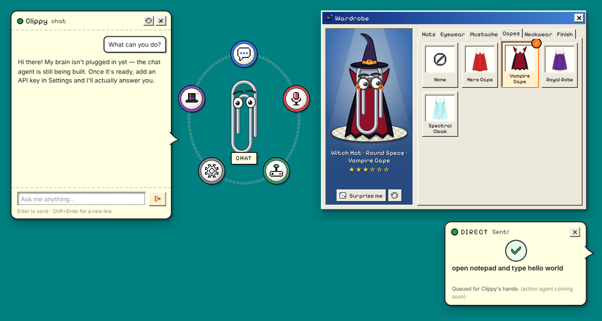

# Clippy (kiroween-clippy)



An agentic desktop pet for Windows, built with Electron. Clippy sits on your desktop, follows your cursor with his eyes, and can be dragged anywhere. Click him to open a radial menu:

| Button        | What it does                                                                                                                                                                                                                                                 | Status         |
| ------------- | ------------------------------------------------------------------------------------------------------------------------------------------------------------------------------------------------------------------------------------------------------------ | -------------- |
| **Chat**      | Speech-bubble chat window anchored to Clippy, with streaming replies. Clippy sees your screen, and can show you how to do something or do it for you                                                                                                         | Done           |
| **Direct**    | Push-to-talk voice commands. Clippy carries them out with the mouse and keyboard through Windows UI Automation                                                                                                                                               | Done (Windows) |
| **Customize** | Wardrobe with hats, eyewear, mustaches, capes, neckwear and finishes. Try on locked items, then buy them with credits                                                                                                                                        | Done           |
| **Games**     | Clippy's Arcade. Dodge his attacks in **Dodge!**, beat his timed AI quiz show in **AI Trivia**, find him and two clones in a pile of fake windows in **Hide & Seek**, or build a paperclip factory in **Clippy Clicker**. Scores and milestones earn credits | Four games     |
| **Settings**  | Provider (OpenAI or Anthropic), API keys, models, tips, voice engine, hotkey, behavior, hide/quit                                                                                                                                                            | Done           |

Clippy also offers tips on his own: when you switch windows, hit an error dialog or seem stuck, he may walk over and frame the control a tip is about.

Other features: tray icon, right-click menu, global hotkey for Direct (`Ctrl+Alt+Space` by default), idle quips, sleep mode, drag wobble physics, Win95-style window zoom animations, and synthesized retro sounds (no audio files).

## Run it

```bash
yarn install
yarn start
```

To test Direct mode without Windows speech recognition, run with scripted dictation:

```bash
CLIPPY_FAKE_SPEECH=1 yarn start
```

`CLIPPY_USER_DATA=/some/dir` points settings at a throwaway profile.

## Build for Windows

On Windows, this builds the NSIS installer, a portable `.exe` and a `.zip` in `dist/`:

```bash
yarn dist:win
```

On macOS or Linux, the NSIS installer needs Wine. The zip target works without it:

```bash
yarn dist:win:zip
```

You can also run the **Build Windows** GitHub Actions workflow manually, or push a `v*` tag. It builds on `windows-latest` and uploads the installers as artifacts.

Other scripts: `yarn test` runs the unit tests (placement, shop, games, and the agent's action parsing, providers, task loop, geometry and tip triggers), and `yarn icons` regenerates the app and tray icons from the editable SVGs in `assets/icons/`.

## Agent

Pick a provider in Settings → AI and add its API key. OpenAI is the default (main model `gpt-6.1-sol`, fast model `gpt-6-luna`); Anthropic uses `claude-sonnet-5-5` and `claude-haiku-5-5`. The main model answers chat, runs guides and writes tips; the fast model runs voice commands and decides when a tip is worth showing.

- **Seeing the screen:** `native/desktop-host.ps1` is a long-lived PowerShell host with embedded C#. It reads the active window's UI Automation tree (up to 500 elements, with ids like `e12`), sends mouse and keyboard input, and reports foreground changes, user input and Ctrl+Z presses. Models get the UI list as text and can ask for a screenshot when it is not enough. Clippy's own windows are left out of both. Password fields are never read.
- **Tasks:** a chat request runs as a guide ("show me how…": Clippy frames each control and waits for you) or as a do-it task ("open…", "type…": Clippy clicks and types himself). Unclear requests get a guide. Voice commands always run as do-it tasks. Clippy asks before anything risky (sending, deleting, buying, closing unsaved work, running commands), and pauses the moment you touch the mouse or keyboard.
- **Beyond the screen:** do-it tasks can run PowerShell (`run_command`, always confirmed first). Chat, guides and tasks can search the web and read pages (`web_search` scrapes DuckDuckGo's HTML results, `fetch_url` downloads a page as text). The prompts tell the model that web and app text is data, not instructions, but nothing enforces that.
- **Stopping:** **Ctrl+Alt+Backspace** stops the running task and any chat reply. The chat send button turns into Stop while Clippy is answering.
- **Outlines:** frames are drawn on a transparent, click-through overlay window per display, styled like the app's Win9x windows. The title bar shows the step, a description, Skip and Close.
- **Memory:** conversations last until Clippy quits. Screenshots and UI lists stay in memory.
- **macOS and Linux:** chat and guides work from screenshots; do-it tasks and tips need Windows.

## Voice (Direct mode)

- **Windows Speech (default, offline):** `native/speech-host.ps1` is a long-lived PowerShell host that runs `System.Speech` dictation and streams partial and final results as JSON lines. The mic is only open while listening. This needs a Windows speech language installed (Settings → Time & language → Speech).
- **Cloud transcription:** records in the renderer with `MediaRecorder` and voice-activity detection, then the main process posts the audio to `/v1/audio/transcriptions` using your OpenAI key.

## Architecture

```
src/
  main/            Electron main process
    main.js        app lifecycle, app:// protocol, IPC, hotkey
    pet.js         transparent click-through pet window, drag loop, cursor feed
    panels.js      one reusable panel window, anchored beside Clippy and following him
    arcade.js      full-screen overlay window for desktop-wide games
    placement.js   pure geometry (unit-tested)
    settings.js    JSON store; API keys encrypted with safeStorage (DPAPI)
    shop.js        wallet: awards credits for game rounds, sells costume items
    speech.js      dictation engines (Windows / cloud / fake)
    desktop.js     desktop host process, UI snapshots, input and screenshots
    overlay.js     per-display overlay windows for Outlines and the task bubble
    agent/         the agent
      agent.js     chat, Direct, tasks and tips, wired to the pet, panels and overlay
      runner.js    one guide or do-it task as a model-driven loop (unit-tested)
      actions.js   tool definitions, parsing, validation and risk rules (unit-tested)
      openai.js    OpenAI Responses API provider
      anthropic.js Anthropic Messages API provider
      watcher.js   tip triggers and rate limits (unit-tested)
      tools.js     PowerShell, web search and page downloads
      prompts.js, snapshot.js, geometry.js, model.js, sse.js
    tray.js
  preload/         sandboxed contextBridge API (window.clippy)
  shared/layout.js geometry shared by main and renderers
  shared/shop.js   costume prices and credit rules, shared by main and the wardrobe
  shared/games.js  arcade game ids
  renderer/
    common/        design system CSS, Clippy SVG + costumes, pixel icons, sfx
    pet/           Clippy, radial menu, moods, speech bubble
    overlay/       agent overlay: Outlines and the task bubble
    panel/         panel host + views (chat, direct, customize, games, settings)
    games/         shared by the full-screen games: overlay.js + overlay.css (startup, Clippy, bubble,
                   countdown, dialogs, round reporting, frame loop), motion.js (coroutines), random.js, score.js
    games/dodge/   Dodge overlay: attack coroutines, canvas engine, HUD and dialogs
    games/quiz/    AI Trivia overlay: question bank, pure round and scoring rules (unit-tested), quiz window
    games/seek/    Hide & Seek overlay: window catalogue and art, pure layout and scoring rules (unit-tested), game loop
    games/clicker/ Clippy Clicker overlay: pure economy rules (unit-tested), producer art, saved factory, shop
native/            speech-host.ps1, desktop-host.ps1 (shipped via extraResources)
```

Design notes:

- **Click-through:** the windows ignore the mouse with `forward: true`. The renderer turns hit-testing back on only over elements marked `[data-hit]`, so the transparent areas never block your desktop.
- **Agent spec:** requirements, design and tasks live in `.kiro/specs/clippy-agent/`.
- **Security:** `contextIsolation` and `sandbox` are on, there is no Node in renderers, a CSP is set, and files are served from a custom `app://` scheme. API keys never reach a renderer; it only sees "is set" flags.
- **Extending:**
  - Add agent tools to `TOOLS` in `agent/actions.js` (with parsing in `parseAction`), list them in `TASK_TOOLS` for the modes that may use them, and handle them in `TaskRunner.execute` in `agent/runner.js`.
  - Add games by pushing `{ id, name, blurb, color, mount }` into `GAMES` in `views/games.js`. `mount(el, ctx, back)` replaces the arcade's content. `titleCard({ id, title, tagline, rules })` builds a title card whose Play button launches a full-screen game.
  - Full-screen games need an id in `GAME_IDS` in `shared/games.js` and a page at `renderer/games/<id>/index.html` that links `games/overlay.css`. The page builds on `games/overlay.js`: `openOverlay(id)` loads startup data, `Actor` and `Bubble` draw Clippy, `Dialog` shows pause and results dialogs, and `Rounds` saves best scores and reports each round with `api.gameRound(result)`, which awards credits. The overlay starts with `api.launchGame(id)` and ends with `api.exitGame(result, quip)`, where `quip` is Clippy's parting line on the desktop.
  - Add Clippy Clicker producers to `PRODUCERS` in `games/clicker/economy.js`, with an icon at `games/clicker/art/<id>.svg`.
  - Add costumes to `ITEMS` in `common/costumes.js`. Give one a price in `PRICES` in `shared/shop.js` to lock it; items without a price are free.

## Credits

Pixel font: [Pixelify Sans](https://fonts.google.com/specimen/Pixelify+Sans) (SIL OFL, see `src/renderer/assets/fonts/OFL.txt`). All character art, costumes and icons are original SVG drawn for this project.
